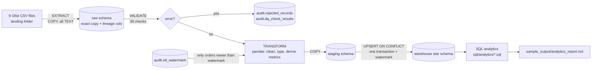
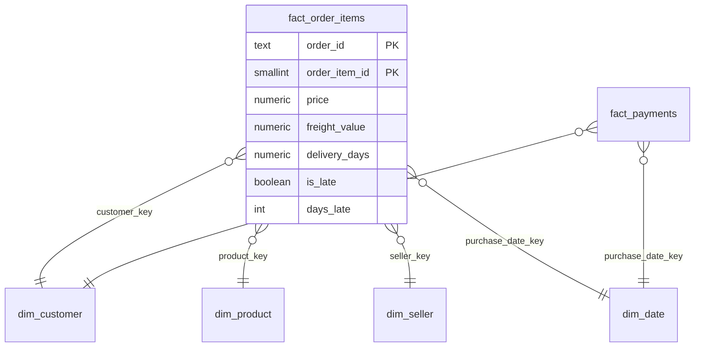

# Supply-Chain Order ETL Pipeline

A batch ETL pipeline that loads the public **Olist Brazilian e-commerce** dataset
(99,441 orders, 112,650 order items, 9 CSV files) into a **PostgreSQL star schema**.
It runs data-quality checks, loads incrementally with a watermark, and answers
delivery-performance questions in SQL.

Built with Python, pandas, SQLAlchemy, PostgreSQL 16, pytest and GitHub Actions.
AI-assisted development (Claude) was used while building it; every result
below was produced by running the code.

## Results (verified)

| What | Result |
|---|---|
| Rows loaded into the fact table | **112,650** (matches the source file exactly) |
| Revenue reconciliation | warehouse 13,591,643.70 = source CSV 13,591,643.70 |
| Incremental runs (3 time-ordered batches) | 16,679 + 34,555 + 61,416 = 112,650 rows, watermark advanced each run |
| Rerun same batch / replay older batch | 0 rows inserted (no duplicates) |
| Full refresh (ignore watermark) | 0 inserted, 112,650 updated in place; duplicates on grain = 0 |
| Data-quality checks per run | 39 (null PK, duplicates, invalid dates, broken FKs, invalid numbers, domain) |
| Issues found in real data | 610 products without category, 166 orders with carrier date before purchase, 8 delivered orders without delivery date, 2 payments with 0 installments (warn-level, loaded) |
| Tests | **34 passed** (24 unit, 10 PostgreSQL integration): see `sample_output/test_report.txt` |
| On-time delivery (order level) | **93.23%** of 96,470 delivered orders (cross-checked with an independent pandas calculation) |

## Architecture



### Star schema



* **Grain** of `fact_order_items`: one row per order item `(order_id, order_item_id)`.
* Dimensions use **surrogate keys** (`SERIAL`) plus a unique natural key, updated
  as **SCD Type 1** (overwrite only when an attribute actually changed).
* `dim_date` is generated (one row per calendar day) with year, month, weekday and so on.
* Full DDL: [`sql/ddl/`](sql/ddl/).

### Why each stage is safe to rerun

| Stage | Mechanism |
|---|---|
| Extract | `TRUNCATE` + `COPY` of each raw table: raw always mirrors the latest landed files |
| Load | `INSERT ... ON CONFLICT (grain) DO UPDATE`: re-sent rows update in place |
| Watermark | advanced **in the same transaction** as the fact load, using `GREATEST()`, so it never moves ahead of the data and never moves backwards |
| Failure | any exception rolls back the load transaction; the run is marked `FAILED` with its error message in `audit.pipeline_runs` (tested by injecting a crash) |
| Bad data spike | circuit breaker: if more than 5% of a table fails error checks, the run aborts instead of loading |

## Project layout

```
src/sc_etl/
  config.py      settings from env / .env (no secrets in code)
  db.py          engine, SQL-file runner, fast COPY loader
  extract.py     CSV -> raw schema, header contract check
  quality.py     39 data-quality checks, reject logic, circuit breaker
  transform.py   pure pandas functions: dimensions, facts, metrics
  watermark.py   read/advance the incremental watermark
  load.py        staging -> warehouse upserts, integrity guard, audit writes
  pipeline.py    orchestration, transactions, run tracking, CLI
sql/ddl/         schemas, raw, audit and warehouse DDL
sql/load/        upsert SQL
sql/analytics/   8 analysis queries (JOIN, GROUP BY/HAVING, CTE, subqueries, window functions)
scripts/         local Postgres setup, batch splitter, analytics runner, daily-run script
tests/           unit + integration tests, synthetic data factory
.github/workflows/ci.yml   runs all tests against a Postgres service container
```

## Setup and run

Requirements: Python 3.11, PostgreSQL 16 (or let the setup script start a local one
via conda's `postgresql` package).

```bash
pip install -r requirements.txt && pip install -e .
python scripts/setup_local_postgres.py          # initdb + start + role + DBs, writes .env
# download the dataset (public Kaggle endpoint) into data/source/
curl -L -o olist.zip https://www.kaggle.com/api/v1/datasets/download/olistbr/brazilian-ecommerce
unzip olist.zip -d data/source

python scripts/split_into_batches.py            # simulate 3 arrivals over time
python -m sc_etl.pipeline --source-dir data/landing/batch_01
python -m sc_etl.pipeline --source-dir data/landing/batch_02
python -m sc_etl.pipeline --source-dir data/landing/batch_03
python -m sc_etl.pipeline --source-dir data/landing/batch_03   # rerun: 0 new rows
python -m sc_etl.pipeline --full-refresh                        # reprocess all: no duplicates
python scripts/run_analytics.py                 # writes sample_output/
pytest -v                                       # needs the olist_test database
```

Scheduling: `scripts/run_daily.ps1` is a ready-to-register Windows Task Scheduler
job (cron line included in the file). It was run end to end once manually; it is
not registered as a scheduled task.

## Key insights (from `sample_output/analytics_report.md`)

* **93.2%** of delivered orders arrive on or before the estimated date, but northeast
  states lag: MA 82.6%, CE 86.2%, BA 87.8%, RJ 87.9%.
* Lateness spikes in **Nov 2017 (12.4%, Black Friday)** and **Feb-Mar 2018 (14.1%, 19.0%)**.
* Top 10 sellers earn 13.2% of revenue: a long-tail marketplace.
* **office_furniture** is the slowest category (20.8 days average vs 12-13 for most).
* SP to RJ is the busiest interstate lane and is late 13.5% of the time, versus 4.6% within SP.

## Known limitations

* The watermark is on `order_purchase_timestamp`, and the source has no
  `updated_at`, so a status change to an *already loaded* order (e.g. delivered
  later) is only picked up by `--full-refresh`. Fix in a real system: CDC or an
  `updated_at` column, or a lookback window.
* Raw is truncate-and-reload (latest batch only); historical raw files are not kept
  in the database.
* pandas holds the batch in memory: fine for ~100k orders. At 100M rows this
  stage should move to SQL (ELT) or Spark.
* Dimensions are compared in full each run (change-only updates); at large scale
  use hash-based change detection.
* Real Olist data produced 0 error-level rejects. Reject handling is proven with
  injected faults in the tests, not with real bad rows.
* The GitHub Actions workflow is written but has not run yet (the repo is not published).
