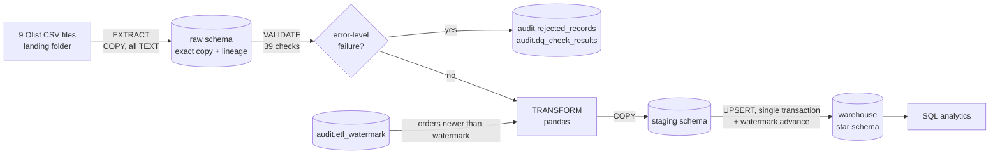
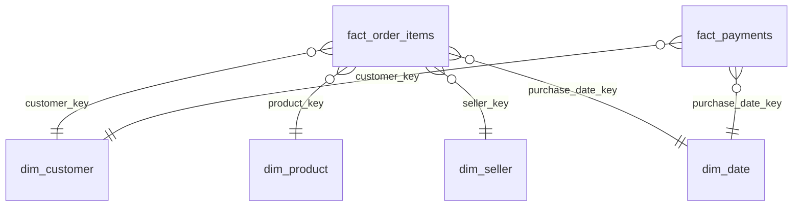

# Project Report: Supply-Chain Order ETL Pipeline

**Author:** G. Sohan, B.Tech Electronics and Communication Engineering
**Type:** Individual data engineering portfolio project
**Date:** November 2026
**Stack:** Python 3.11 · pandas 2.2 · SQLAlchemy 2.0 · PostgreSQL 16 · pytest · GitHub Actions

---

## Table of contents
1. [Abstract](#1-abstract)
2. [Problem statement and objectives](#2-problem-statement-and-objectives)
3. [Dataset](#3-dataset)
4. [Technology choices](#4-technology-choices)
5. [System architecture](#5-system-architecture)
6. [Data model](#6-data-model)
7. [Implementation](#7-implementation)
8. [Data quality](#8-data-quality)
9. [Incremental loading and rerun safety](#9-incremental-loading-and-rerun-safety)
10. [SQL analytics and business insights](#10-sql-analytics-and-business-insights)
11. [Testing and verification](#11-testing-and-verification)
12. [Challenges and solutions](#12-challenges-and-solutions)
13. [Limitations](#13-limitations)
14. [Future work](#14-future-work)
15. [Conclusion](#15-conclusion)
16. [How to reproduce](#16-how-to-reproduce)
17. [References and acknowledgements](#17-references-and-acknowledgements)

---

## 1. Abstract

This project implements an end-to-end batch **ETL (Extract-Transform-Load)** pipeline
for e-commerce supply-chain data. It ingests the public **Olist Brazilian e-commerce**
dataset (9 CSV files, 99,441 orders, 112,650 order items) into a **PostgreSQL star
schema**, enforces **39 automated data-quality checks**, and loads data
**incrementally** using a timestamp watermark. Every stage is safe to rerun without
creating duplicates.

The warehouse reconciles exactly with the source: 112,650 fact rows and
R$13,591,643.70 of product revenue on both sides. SQL analysis shows that **93.23%**
of 96,470 delivered orders arrived on time. Late deliveries concentrate in
north-eastern states (Maranhão 82.6% on time) and in specific months (19.0% late in
March 2018). The pipeline is covered by **34 automated tests** (24 unit, 10
integration against a real PostgreSQL database), all passing.

---

## 2. Problem statement and objectives

An e-commerce marketplace stores orders, items, customers, sellers, products,
payments and reviews in separate operational exports. Answering supply-chain
questions such as *"What share of orders arrive on time?"*, *"Which regions and months
are late?"* and *"Which sellers drive revenue?"* requires joining these sources
correctly, removing bad data, and storing the result in a structure designed for
analysis.

**Objectives**

| # | Objective | Status |
|---|---|---|
| O1 | Extract all source CSVs into PostgreSQL without altering them | Achieved |
| O2 | Validate data: null keys, duplicates, invalid dates, broken foreign keys, invalid numbers | Achieved (39 checks) |
| O3 | Clean, type and transform the data into a star schema (facts + dimensions) | Achieved |
| O4 | Load incrementally using a watermark | Achieved |
| O5 | Make every run safely rerunnable without duplicates | Achieved and tested |
| O6 | Answer business questions with SQL (JOINs, GROUP BY/HAVING, CTEs, subqueries, window functions) | Achieved (8 queries) |
| O7 | Logging, exception handling and automated tests | Achieved (34 tests) |
| O8 | Document architecture and execution | Achieved |

---

## 3. Dataset

**Source:** *Brazilian E-Commerce Public Dataset by Olist* (Kaggle), real anonymised
orders from 2016–2018.

| File | Rows | Role in the model |
|---|---|---|
| `olist_orders_dataset.csv` | 99,441 | order header, status, 5 timestamps |
| `olist_order_items_dataset.csv` | 112,650 | **fact grain**: one row per item |
| `olist_order_payments_dataset.csv` | 103,886 | payment fact |
| `olist_order_reviews_dataset.csv` | ~99k (multi-line text) | review score per order |
| `olist_customers_dataset.csv` | 99,441 | customer dimension |
| `olist_products_dataset.csv` | 32,951 | product dimension |
| `olist_sellers_dataset.csv` | 3,095 | seller dimension |
| `product_category_name_translation.csv` | 71 | Portuguese to English categories |
| `olist_geolocation_dataset.csv` | 1,000,163 | landed in raw only (not needed by the star schema) |

**Relationships:** `orders.customer_id → customers`; `order_items.order_id → orders`;
`order_items.product_id → products`; `order_items.seller_id → sellers`;
`payments.order_id → orders`; `reviews.order_id → orders`.

**Data characteristics discovered during inspection**
* Zip-code prefixes have leading zeros (`01037`), so they must be read as text.
* Review comments contain line breaks inside quoted fields.
* The translation file starts with a UTF-8 byte-order mark.
* Estimated delivery dates are always at `00:00:00` (date precision only).

---

## 4. Technology choices

| Technology | Why it was chosen | When an alternative would be better |
|---|---|---|
| **PostgreSQL 16** | Full SQL (CTEs, window functions, `ROLLUP`, `PERCENTILE_CONT`), transactions, `INSERT ... ON CONFLICT` upserts, fast `COPY` bulk load | Snowflake / Redshift / BigQuery for terabyte scale |
| **pandas** | ~100k rows fit easily in memory; transformations are concise and easy to unit-test | Spark, or in-database SQL (ELT), at hundreds of millions of rows |
| **SQLAlchemy 2.0** | Connection pooling, explicit transaction blocks (`engine.begin()`), safe parameter binding | — |
| **psycopg2 `COPY`** | Bulk loading is far faster than row-by-row `INSERT` | — |
| **pytest** | Unit tests for pure functions plus integration tests against a real database | — |
| **GitHub Actions** | CI that runs all tests against a PostgreSQL service container on every push | — |

---

## 5. System architecture



The database is organised in four schemas:

| Schema | Purpose | Load behaviour |
|---|---|---|
| `raw` | exact copy of the source files, every column `TEXT`, plus `_source_file`, `_run_id`, `_ingested_at` | truncate + reload each run |
| `staging` | cleaned, typed rows for the current run | truncated each run |
| `warehouse` | star schema used for analysis | upsert (insert or update) |
| `audit` | run history, watermark, data-quality results, rejected rows | append |

Keeping `raw` untyped means a bad value (for example an unparseable date) is never
lost or silently converted during loading; it stays visible for the quality checks.

---

## 6. Data model



**Grain.** `fact_order_items` holds one row per order item, with primary key
`(order_id, order_item_id)`. `fact_payments` holds one row per payment
`(order_id, payment_sequential)`.

**Facts and derived measures**

| Column | Meaning |
|---|---|
| `price`, `freight_value`, `item_total` | money (BRL), with `CHECK` constraints (price > 0, freight ≥ 0) |
| `delivery_days` | purchase to customer delivery, in days |
| `is_delivered` | status is `delivered` and a delivery date exists |
| `is_late` / `days_late` | delivered on a later **calendar day** than estimated; NULL if not delivered |
| `order_review_score` | average review score of the order |

**Dimensions** (row counts after loading): `dim_customer` 99,441 · `dim_product`
32,951 · `dim_seller` 3,095 · `dim_date` 774 days (2016-09-04 to 2018-10-17).

Dimensions use **surrogate keys** (`SERIAL`) alongside a unique natural key and are
maintained as **SCD Type 1**: an attribute is overwritten only when it actually
changed (`IS DISTINCT FROM`). This avoids rewriting 100k unchanged rows on every run.

Full DDL: `sql/ddl/01_schemas_and_raw.sql`, `02_audit.sql`, `03_warehouse.sql`.

---

## 7. Implementation

| Module | Responsibility |
|---|---|
| `src/sc_etl/config.py` | Settings from environment variables or a git-ignored `.env`; no secrets in code |
| `src/sc_etl/extract.py` | Reads each CSV as strings, checks the header against a data contract, `TRUNCATE` + `COPY` into `raw` |
| `src/sc_etl/quality.py` | 39 checks; builds per-table reject masks; circuit breaker |
| `src/sc_etl/transform.py` | Pure pandas functions: cleaning, dimensions, facts, metrics |
| `src/sc_etl/watermark.py` | Reads and advances the incremental watermark |
| `src/sc_etl/load.py` | `COPY` into staging, SQL upserts into the warehouse, integrity guard, audit writes |
| `src/sc_etl/pipeline.py` | Orchestration, transaction boundaries, run tracking, CLI |

**Transaction boundaries**

| Step | Transaction | Why |
|---|---|---|
| T1 | create run record | committed immediately, so a crash still leaves a trace |
| T2 | extract CSV into raw | raw is a snapshot of the landed files |
| T3 | write data-quality results and rejected rows | kept even if the load later fails, for investigation |
| T4 | staging → warehouse upserts **and** watermark update | all-or-nothing |
| T5 | mark run `SUCCESS` or `FAILED` with the error message | operational visibility |

**Integrity guard.** After the fact upsert, the number of rows staged must equal the
number inserted plus updated. A mismatch means an inner join to a dimension silently
dropped rows, so the run fails instead of under-loading.

---

## 8. Data quality

Checks are evaluated on the raw string data. **Error**-level failures are rejected and
written to `audit.rejected_records` with the check name; **warn**-level failures are
counted and logged but loaded.

| Category | Examples of checks | Severity |
|---|---|---|
| Null primary keys | `orders_null_pk`, `order_items_null_pk`, … | error |
| Duplicates | duplicate primary keys (first copy kept, extras rejected) | error |
| Invalid dates | unparseable or out-of-range timestamps; delivered before purchase | error |
| Broken foreign keys | item → order, item → product, item → seller, order → customer, payment → order | error |
| Invalid numbers | price ≤ 0, freight < 0, negative payment, review score outside 1–5 | error |
| Domain / plausibility | unknown order status, missing category, approved or shipped before purchase, 0 installments | warn |

**Cascading foreign keys.** Parent tables are checked first. If an order is rejected,
its items then fail the item → order check, so no orphan rows reach the warehouse.

**Circuit breaker.** If more than 5% of any table fails error-level checks, the run
aborts before loading. A sudden spike of bad rows usually indicates an upstream
defect, not genuinely bad records.

**Findings on the real Olist data** (all warn-level, loaded):

| Check | Rows |
|---|---|
| Products without a category (loaded as `unknown`) | 610 |
| Orders whose carrier pickup is earlier than the purchase | 166 |
| Orders marked delivered without a delivery date | 8 |
| Payments with 0 installments | 2 |
| Products with non-positive weight | 6 |

The real data had **no error-level failures**, so 0 rows were rejected. The reject
path is verified with deliberately injected faults in the test suite (section 11).

---

## 9. Incremental loading and rerun safety

**Watermark.** `audit.etl_watermark` stores the latest `order_purchase_timestamp`
loaded. Each run processes only orders strictly newer than it. The watermark is
updated **in the same transaction** as the fact load, using `GREATEST()`, so it can
never move ahead of the data or backwards.

**Idempotency.** Fact rows are written with `INSERT ... ON CONFLICT (grain) DO UPDATE`,
so re-sent rows update in place instead of duplicating.

**Experiment.** The dataset was split by purchase date into three landing batches to
simulate data arriving over time:

| Run | Input | Watermark before → after | Fact rows inserted | Updated |
|---|---|---|---|---|
| 1 | batch 1 (≤ 2017-06-30) | none → 2017-06-30 23:20:08 | 16,679 | 0 |
| 2 | batch 2 (H2 2017) | → 2017-12-31 23:29:31 | 34,555 | 0 |
| 3 | batch 3 (2018) | → 2018-10-17 17:30:18 | 61,416 | 0 |
| 4 | batch 3 again | unchanged | **0** | 0 |
| 5 | batch 1 replayed | unchanged | **0** | 0 |
| 6 | full refresh (watermark ignored) | → 2018-10-17 17:30:18 | **0** | **112,650** |

Total: 16,679 + 34,555 + 61,416 = **112,650** = the source item count. Duplicate rows
on the grain after all runs: **0**.

---

## 10. SQL analytics and business insights

| File | Question | SQL techniques |
|---|---|---|
| `01_on_time_delivery_by_state.sql` | on-time % overall and by state | CTE, JOIN, `GROUP BY ROLLUP`, `HAVING`, `FILTER` |
| `02_monthly_delivery_delays.sql` | monthly late % and change | chained CTEs, `LAG()` |
| `03_top_10_sellers_by_revenue.sql` | top sellers, share, cumulative share | `RANK()`, `SUM() OVER ()`, running sum |
| `04_avg_delivery_time_by_category.sql` | average and median delivery days | `GROUP BY`/`HAVING`, `PERCENTILE_CONT` |
| `05_sellers_late_rate_above_average.sql` | sellers late at more than 2× average | derived table, scalar subquery in `HAVING` |
| `06_monthly_revenue_running_total.sql` | revenue trend | window frames, moving average, `NULLIF` |
| `07_shipping_lanes.sql` | busiest seller → customer state lanes | multi-join, `ROW_NUMBER()` |
| `08_pipeline_audit.sql` | operational run history | correlated subquery |

**Grain handling.** Delivery is an *order*-level event, but the fact table is at
*item* grain. Delivery KPIs therefore first collapse to one row per order
(`GROUP BY order_id`, `BOOL_OR(is_late)`). Otherwise an order with three items would
count three times.

**Lateness definition.** Estimated dates carry no time of day (`00:00:00`), so
lateness compares calendar days. A parcel delivered at 14:00 on the estimated date
counts as on time.

### Key results

**On-time delivery: 93.23%** of 96,470 delivered orders. An independent pandas
calculation directly on the CSVs gave the same value.

| State | Delivered orders | On time |
|---|---|---|
| MA (lowest) | 717 | 82.57% |
| CE | 1,279 | 86.24% |
| BA | 3,256 | 87.84% |
| RJ | 12,350 | 87.89% |
| SP | 40,494 | 95.51% |
| PR (highest) | 4,923 | 95.96% |

**Monthly late-delivery peaks:** Nov 2017 12.4% (Black Friday volume), Feb 2018 14.1%,
Mar 2018 **19.0%**, falling to 1.2% by Jun 2018.

**Sellers:** the top seller earned R$229,237.63 (1.70% of revenue). The top 10 together
earned 13.2%, a long-tail marketplace. 30 sellers with at least 50 orders are late
more than twice the marketplace average.

**Categories:** `office_furniture` is the slowest (20.8 days average, 19.0 median),
against 12–13 days for most categories.

**Shipping lanes:** SP → SP is the busiest lane (30,829 orders, 7.9 days, 4.6% late).
SP → RJ is a weak spot (16.1 days, **13.5% late**), and SP → BA takes 19.7 days.

Full outputs: `sample_output/analytics_report.md` and `sample_output/analytics/*.csv`.

---

## 11. Testing and verification

**Automated tests: 34 passed** (`sample_output/test_report.txt`).

| Suite | Count | What it proves |
|---|---|---|
| `test_extract.py` | 4 | leading zeros kept, BOM stripped, multi-line text, header contract |
| `test_transform.py` | 10 | date keys, text cleaning, category fallback, lateness and delivery metrics, strict watermark filter |
| `test_quality.py` | 14 | each injected fault type detected with an exact count; cascade; duplicate keeps first; circuit breaker |
| `test_pipeline_integration.py` | 6 | rerun and full-refresh idempotency; incremental load; dirty data rejected and audited; missing file marks the run FAILED; **a crash after the fact insert rolls back both facts and watermark**; circuit breaker stops the load |

Integration tests use a synthetic, Olist-shaped data factory against a separate
`olist_test` database, so they also run in CI without the Kaggle download.

**Reconciliation checks against the source**

| Check | Warehouse | Source CSV |
|---|---|---|
| Item rows | 112,650 | 112,650 |
| Product revenue | 13,591,643.70 | 13,591,643.70 |
| Distinct orders with items | 98,666 | 98,666 |
| On-time % (independent pandas calculation) | 93.23% | 93.23% |
| Top seller revenue | 229,237.63 | 229,237.63 |

`scripts/verify_warehouse.py` repeats the row and revenue reconciliation in one command.

---

## 12. Challenges and solutions

| Challenge | Solution |
|---|---|
| Delivery KPIs at the wrong grain would double-count multi-item orders | collapse to order level before aggregating |
| Estimated delivery dates at midnight would make same-day deliveries look late | compare calendar days, not timestamps |
| Zip prefixes lose leading zeros when parsed as numbers | read everything as text in raw; `zfill(5)` when cleaning |
| `pd.read_sql(..., dtype=str)` turns NULL into the literal string `'None'` | read without `dtype`; TEXT columns already arrive as strings |
| `%` inside SQL comments was read as a psycopg2 parameter placeholder | execute analysis SQL through SQLAlchemy `text()` |
| A crash between the fact load and the watermark update could skip data | single transaction for both; verified by a test that injects a crash |
| psycopg2 crashed (segfault) on Windows | a conflicting OpenSSL DLL from another tool was first on `PATH`; an environment script puts the project's DLLs first |
| A test fixture with orphan payments was blocked from loading | the circuit breaker worked as designed; the fixture was corrected |

---

## 13. Limitations

* **Late updates.** The watermark uses the purchase timestamp and the source has no
  `updated_at` column, so status changes to orders already loaded (for example a later
  delivery) are only picked up by `--full-refresh`.
* **Raw history.** Raw is truncate-and-reload, so only the latest landed batch is kept
  in the database.
* **Scale.** pandas holds each batch in memory, which suits ~100k orders but not
  hundreds of millions of rows.
* **Real rejects.** The Olist data produced no error-level rejects; reject handling is
  proven only with injected faults.
* **Not yet run:** the CI workflow (it runs once the repository is on GitHub) and the
  daily scheduled job (the script was run manually, not registered with a scheduler).

---

## 14. Future work

1. Change data capture or an `updated_at` column, or a reprocessing lookback window,
   to capture late status changes.
2. Move transforms into SQL models (for example dbt) for a pure ELT design at scale.
3. Keep raw history partitioned by load date for full auditability.
4. Orchestrate with Apache Airflow and alert on failed runs.
5. Port the warehouse to Snowflake and compare cost and performance.

---

## 15. Conclusion

The pipeline meets every stated objective. It loads all 112,650 order items into a
validated star schema that reconciles exactly with the source, it can be rerun or
fully refreshed without creating duplicates, and its SQL layer turns raw exports into
concrete supply-chain insights: 93.2% on-time delivery, under-served north-eastern
states, seasonal late-delivery peaks and slow shipping lanes. The most important
engineering lessons were to define the grain before writing metrics, to make the load
and its watermark atomic, and to verify results against the source independently
instead of trusting the pipeline's own output.

---

## 16. How to reproduce

```bash
pip install -r requirements.txt && pip install -e .
python scripts/setup_local_postgres.py            # local PostgreSQL + .env (git-ignored)
# download the dataset into data/source/
curl -L -o olist.zip https://www.kaggle.com/api/v1/datasets/download/olistbr/brazilian-ecommerce
unzip olist.zip -d data/source
python scripts/split_into_batches.py
python -m sc_etl.pipeline --source-dir data/landing/batch_01   # repeat for batch_02, batch_03
python scripts/run_analytics.py
python scripts/verify_warehouse.py
pytest -v
```

---

## 17. References and acknowledgements

* Olist, *Brazilian E-Commerce Public Dataset by Olist*, Kaggle, licensed CC BY-NC-SA 4.0.
  The dataset is not redistributed in this repository.
* PostgreSQL 16 documentation: `INSERT ... ON CONFLICT`, `COPY`, window functions.
* Kimball and Ross, *The Data Warehouse Toolkit* (star schema, grain, slowly changing dimensions).
* AI-assisted development: an AI coding assistant (Claude) was used during
  implementation. All results in this report come from executing the code.
